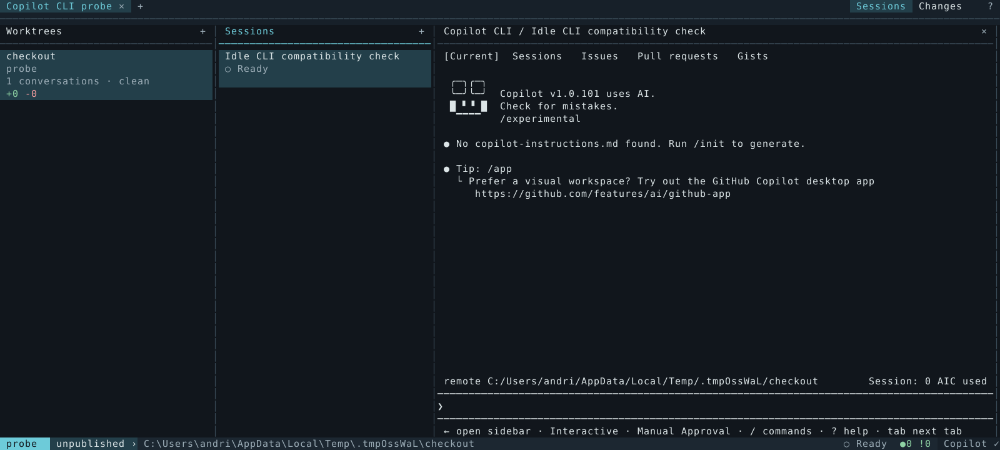

# Tree Rail

**Projects. Git worktrees. Agent conversations.**

A native Rust terminal application that keeps Copilot beside your worktrees and Git changes. Project tabs share one header; switch between Sessions and Changes without moving the panes. A single status line keeps branch, tracking, checkout path and agent activity in view.



## Run

```powershell
cargo run --release -- "C:\Code"
```

Requires Git and an interactive terminal. Building requires Rust 1.94 or later. The official Copilot Rust SDK bundles its matching native runtime; no Node.js installation or persistent Tree Rail service is required. Copilot access requires a GitHub account with Copilot access. Sign in with `gh auth login`, or provide `COPILOT_GITHUB_TOKEN` (`GH_TOKEN` and `GITHUB_TOKEN` are also supported). Tree Rail forwards the credential to the advertised GitHub resource, using Copilot's encrypted, connection-bound authentication envelope when required. Credentials are never saved in Tree Rail state. `cargo run --example ahp_probe` verifies the real AHP handshake and catalog without creating a session or sending a model prompt.

```text
treerail --list /path/to/projects
treerail --temporary /path/to/one-off-project
treerail --config /path/to/config.toml
```

Start in the project explorer. Open projects into tabs, choose a worktree, and use the small **+** beside Worktrees or Sessions. Sessions **+** opens a new Copilot conversation directly, ready for input in the CLI. Help → New session with options / new worktree retains the optional combined creation flow. Worktree rows show green additions and red deletions against HEAD, including untracked text files. New worktrees start from the selected worktree's branch. Browse local and remote branches with fuzzy search, then reuse the selected branch for review or name a new branch. Fetching and the configured checkout location are automatic. Push publishes an unpublished branch and sets its upstream automatically.

Use **?** for Git, conversation and application commands. `Ctrl+P` opens projects, `v` switches views, `Tab` changes panes, and `j/k` navigate. `i` or clicking the right pane focuses the real Copilot CLI. **Ctrl+] returns to Tree Rail navigation**; while focused, Copilot receives its normal keys, including Tab, Esc and Ctrl+C. Close a running project's tab after confirming to hide it without stopping its sessions. Quit confirms stopping owned runtime work; saved conversations resume explicitly.

## Configuration and state

Windows uses `%LOCALAPPDATA%\treerails\`; Unix uses `$XDG_CONFIG_HOME/treerails/` or `~/.config/treerails/`. Both documents load before the first frame:

- `config.toml`: declared sources, discovery preferences, worktree locations and provider configuration.
- `state.json`: remembered paths, known projects, tabs, selections, conversation history and drafts.

Opening another path updates state, leaving configuration alone. Existing combined documents migrate with a complete `config.pre-worktree-refactor.toml` backup; historical ticket/task data stays in that backup. `--list` never creates, migrates or updates files.

See the [example configuration](examples/config.toml), [usage guide](docs/usage.md), [product specification](docs/product-spec.md), and [validation status](docs/testing/worktree-release.md). Earlier ticket-workflow documents are historical and superseded by ADRs [0010](docs/adr/0010-separate-configuration-from-remembered-state.md) and [0011](docs/adr/0011-return-to-worktrees-with-native-ahp-conversations.md).

## The real Copilot CLI over AHP

The right pane runs the actual Copilot CLI in a child terminal, using Windows ConPTY or a Unix PTY. Copilot owns the live conversation, menus, attachments, permissions and keyboard behavior. Tree Rail handles resizing and keeps each opened terminal alive while switching views. Closing a terminal disconnects that frontend; it does not cancel the agent turn. Tree Rail keeps read-only cached history when no terminal is open.

The CLI attaches to the same AHP session observed by Tree Rail, rather than creating a second conversation. Copilot's official SDK owns the temporary runtime and authenticated listener; use Help → AHP connection details to inspect its private endpoint. The CLI's AHP client is experimental and requires a compatible version. The bundled full CLI is the default; `[agent].cli` overrides the frontend separately from `[agent].runtime`, the SDK backend. Tree Rail enables the AHP client feature and GitHub authentication sharing for a trusted loopback or TLS host. Connection secrets stay out of command arguments and saved state.

An external AHP host can be configured explicitly. Interoperability depends on its protocol and provider support. Windows checks cover native CLI rendering, typing and resizing, plus discovery of the same idle session by VS Code. A real model conversation and interactive VS Code handoff remain release checks. Use Tree Rail's rails to switch worktrees; Copilot's own session navigation is independent of Tree Rail's launch association. Terminal graphics and clipboard escape extensions are not implemented.

Copilot asks before trusting a new checkout; Cancel preserves the unsent prompt. Its native AHP host also limits filesystem access to its launch workspace. Tree Rail derives that workspace from remembered project sources and configured worktree locations. `[agent].host_directory` overrides it explicitly. After adding a project outside the current host scope, restart Tree Rail before starting a conversation there.

## Development

```text
cargo fmt --all -- --check
cargo clippy --all-targets --locked -- -D warnings
cargo test --locked
cargo run --example capture_demo
```

Tests use disposable repositories, real child terminals and a deterministic local AHP host. They cover remote-default fetching, publication, cleanup protections, storage migration, checkout leases, terminal rendering/input/lifetime and stable TUI layout. No model prompts are sent by the test suite. Published downloads are available on the [GitHub releases page](https://github.com/andikon/treerails/releases).
