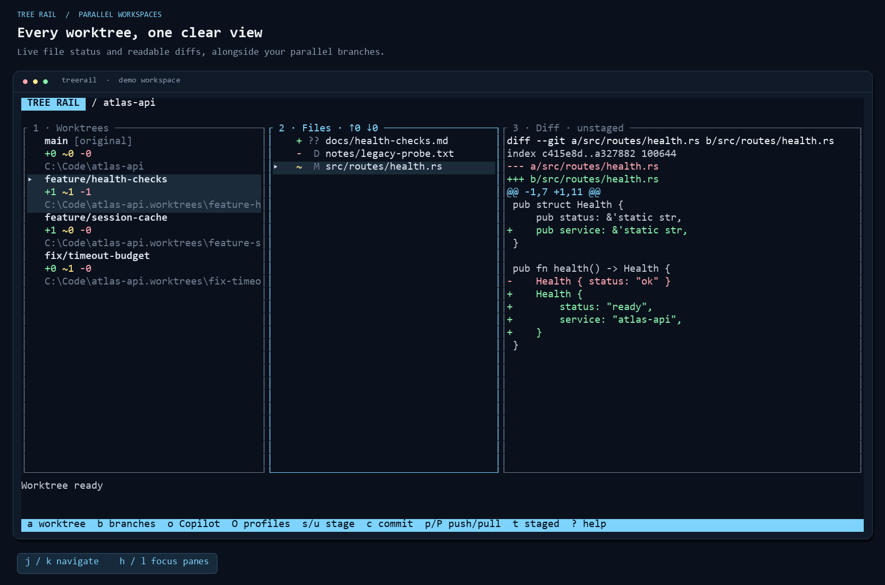
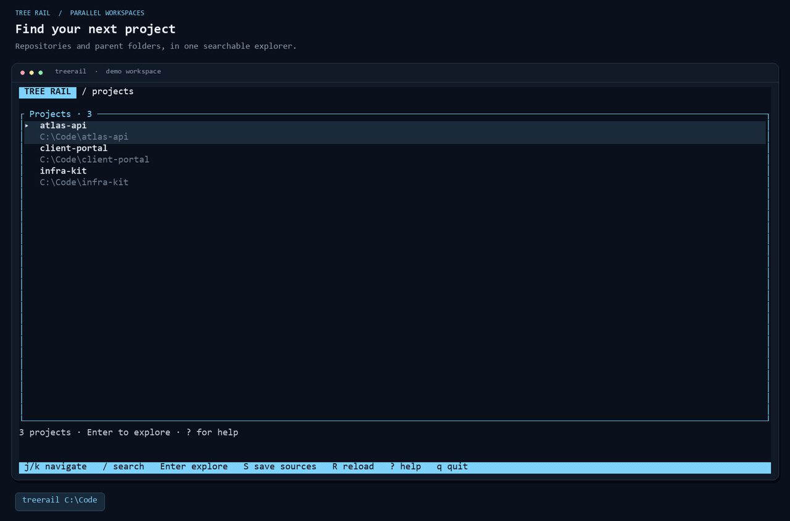
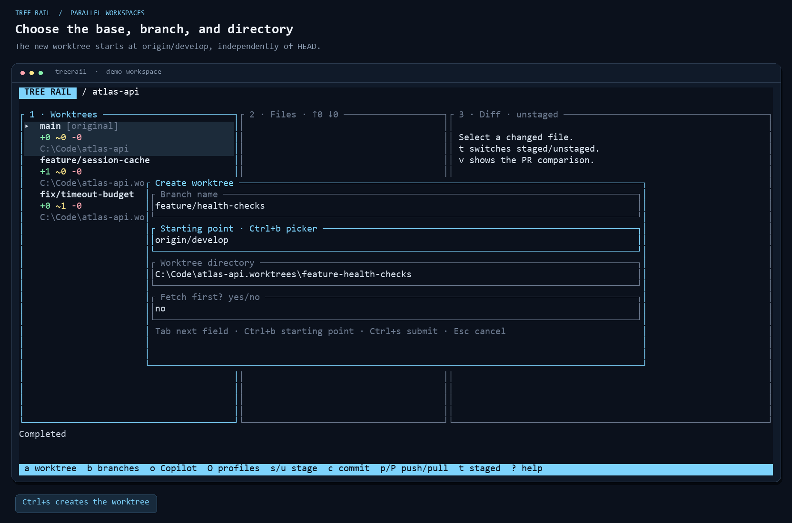
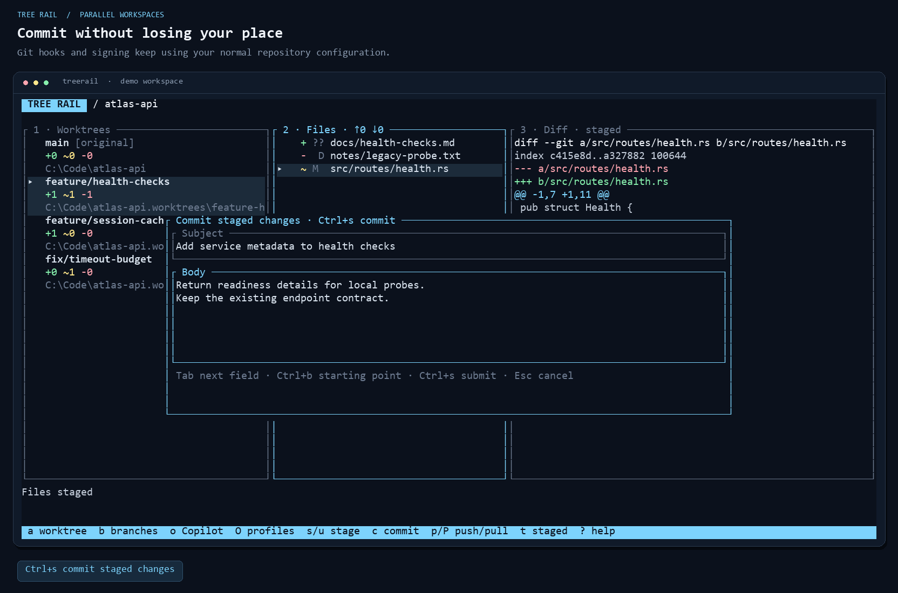
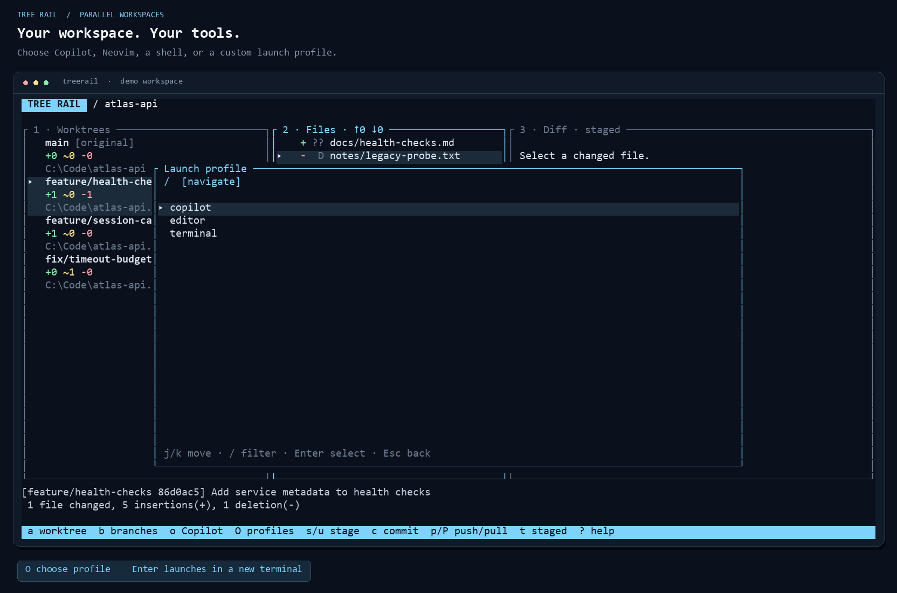

<div align="center">

# Tree Rail

**Your projects. Your branches. Room to work in parallel.**

A native terminal explorer for Git worktrees and agent-assisted development.<br>
Find a project, choose a starting branch, and open your tools in the right workspace.

`Rust` · `Ratatui` · `Vim navigation` · `Windows · macOS · Linux`

[Quick start](#quick-start) · [Watch the demo](#see-it-in-action) · [Keyboard controls](#keyboard-controls) · [Configuration](#make-it-yours) · [Usage guide](docs/usage.md)

</div>



## Built for the next ticket

Feature development and code review often begin with the same steps: find the repository, find the right branch, create a worktree, and open a terminal. Tree Rail puts those steps in one keyboard-driven interface and stays open while you work.

| Your next step | Tree Rail handles |
| --- | --- |
| **Find the project** | Load repositories, parent folders, saved roots, or a file of paths. Search once and jump in. |
| **Choose a workspace** | Select an existing worktree or create one from a local branch, remote branch, tag, or commit. |
| **Bring your tools** | Launch Copilot, Neovim, a shell, or a custom profile in a new terminal with the worktree as its working directory. |
| **Keep Git close** | Inspect live changes and diffs, stage files, commit, fetch, pull, and publish branches. |
| **Prepare a review** | Pick a GitHub PR or enter its number/URL, prepare a review worktree, and inspect its merge-base diff. |

## See it in action

A roughly **24-second walkthrough**: select a project → create a worktree from `origin/develop` → inspect changes → stage and commit → choose a launch profile.

[](docs/media/demo.mp4)

**[Watch or download the MP4](docs/media/demo.mp4)** · [Open the animated GIF](docs/media/demo.gif)

<sub>The screenshots and scripted demo use Tree Rail's real Ratatui renderer, keyboard handlers, and disposable Git repositories. Demo paths are normalized to <code>C:\Code</code>. The clip ends at profile selection; it does not launch an external agent.</sub>

<details>
<summary><strong>Explore the screenshots</strong></summary>

| Project discovery | Worktree creation |
| --- | --- |
| [](docs/media/projects.png) | [](docs/media/create-worktree.png) |

| Commit form | Launch profiles |
| --- | --- |
| [](docs/media/commit.png) | [](docs/media/launch-profiles.png) |

[View the staged-diff screenshot](docs/media/staged-diff.png). Click any image for its full size.

</details>

## Quick start

### Download a prebuilt binary

**[Get the latest release →](https://github.com/andikon/treerails/releases/latest)** No Rust installation or build tools required.

| Your machine | Download |
| --- | --- |
| **Windows · Intel/AMD 64-bit** | [Standalone EXE](https://github.com/andikon/treerails/releases/latest/download/treerail-windows-x86_64.exe) · [ZIP with documentation](https://github.com/andikon/treerails/releases/latest/download/treerail-windows-x86_64.zip) |
| **Linux · Intel/AMD 64-bit** | [TAR.GZ](https://github.com/andikon/treerails/releases/latest/download/treerail-linux-x86_64.tar.gz) |
| **macOS · Apple Silicon** | [TAR.GZ](https://github.com/andikon/treerails/releases/latest/download/treerail-macos-aarch64.tar.gz) |
| **macOS · Intel** | [TAR.GZ](https://github.com/andikon/treerails/releases/latest/download/treerail-macos-x86_64.tar.gz) |

On Windows, download the EXE, rename it to `treerail.exe`, and put it in a folder such as `C:\Tools\TreeRail`. Open a terminal in that folder and run:

```powershell
.\treerail.exe 'C:\Code'
```

Add the folder to your user `PATH` to run `treerail` from anywhere. Alternatively, extract the ZIP; it already contains `treerail.exe`, the usage guide, and an example configuration.

On macOS or Linux, extract the archive and run `./treerail ~/code`. Move the executable to a directory on `PATH` for convenient access. Linux downloads are static musl builds. The release includes `SHA256SUMS`; compare a download with `Get-FileHash -Algorithm SHA256` on Windows or `shasum -a 256` on macOS/Linux. Binaries are currently unsigned and macOS builds are not notarized.

Git must be installed on the machine. See the optional tool requirements below.

### Install from a local checkout

With a stable Rust toolchain and Git installed:

```powershell
cargo install --path . --locked
treerail 'C:\Code'
```

Or build and run directly:

```powershell
cargo build --release --locked
.\target\release\treerail.exe 'C:\Code'
```

On Linux and macOS, the built executable is `./target/release/treerail`.

### Point it at your projects

```powershell
# A repository or the direct parent of several repositories
treerail 'C:\Code'

# Several roots, including projects on another drive
treerail 'C:\Code\atlas-api' 'D:\Projects'

# Saved sources and explicit recursive discovery
treerail --paths-file projects.txt
treerail --recursive 'C:\Code'
```

Press **`S`** to save the current roots. Future launches can use just `treerail`. Direct children are scanned by default; folders containing `.worktrees` are excluded from project discovery and appear under their owning repository instead.

### Requirements

- **Git** on `PATH` for repository operations.
- **Copilot CLI** for the default agent profile; **Neovim** for the editor profile.
- **GitHub CLI**, authenticated with `gh auth login`, for PR features.
- A modern terminal. The automatic launch adapter uses Windows Terminal, Terminal.app on macOS, or a configured/detected Linux terminal.

The terminal-only profile works without Copilot or Neovim. Building on Windows requires the Rust MSVC toolchain and Visual C++ build tools; running the built executable requires no Rust installation.

## From ticket to worktree

1. **Choose a project.** Navigate with `j/k`, search with `/`, and press `Enter`.
2. **Create your workspace.** Press `a`, name the branch, and use `Ctrl+b` to choose its starting point. Review the directory and press `Ctrl+s`.
3. **Open your tools.** Press `o` to launch the default profile, or `O` to choose one. Tree Rail stays open.
4. **Inspect and commit.** Move between panes with `h/l`. Mark files with `Space`, stage with `s`, and press `c` for the commit form.
5. **Publish and finish.** Press `p` to push or publish under the same branch name. Once the work is finished, `d` removes a clean linked worktree and retains its branch.

Worktrees follow the sibling-directory convention used by Copilot:

```text
C:\Code\atlas-api
C:\Code\atlas-api.worktrees\feature-health-checks
C:\Code\atlas-api.worktrees\review-pr-128
```

Choosing a branch that is already checked out selects its existing worktree. New feature branches publish under their own name, so `feature/health-checks` suggests `origin/feature/health-checks` when no upstream exists.

Pulls use **fast-forward only**. Worktree removal refuses uncommitted changes and protects the original checkout. Local branch deletion is a separate action with Git's normal merge protections.

## Keyboard controls

| Keys | Action |
| --- | --- |
| `j/k` · `gg/G` · `Ctrl+u/d` | Move, jump to the first/last item, or move half a page |
| `h/l` · `Tab` · `Ctrl+w` then `h/j/k/l` | Move between panes |
| `/` · `n/N` | Search and move between results |
| `a` · `b` | Create a worktree or open branch actions |
| `o` · `O` | Launch the default profile or choose another |
| `Space` · `s/u` · `t` | Mark files, stage/unstage, toggle staged/unstaged diffs |
| `c` · `f` · `p/P` | Commit, fetch, push/publish, pull |
| `r` · `v` · `w` | Choose a PR, view its comparison, open it in a browser |
| `d` · `R` · `S` | Remove a worktree, refresh, save project roots |
| `?` · `Esc` · `q` | Help, close/back, back/quit |

Forms receive ordinary text. Use `Tab` to change fields and `Ctrl+s` to submit. Pickers support Vim navigation and `/` to enter a filter. **[Complete keyboard reference →](docs/usage.md#keyboard-controls)**

## Make it yours

Tree Rail uses readable **TOML configuration** for roots, per-project defaults, launch profiles, keybindings, and colors. Remembered selections and starting points live in a separate `state.json`.

```toml
project_roots = ['C:\Code', 'D:\Projects']
default_profile = 'copilot'

[profiles.editor]
program = 'nvim'
args = ['.']
cwd = '{worktree}'
terminal = 'auto'

[[projects]]
path = 'C:\Code\atlas-api'
base = 'origin/develop'
default_profile = 'editor'
```

Start with **[examples/config.toml](examples/config.toml)**, then run:

```powershell
Copy-Item '.\examples\config.toml' '.\treerail.toml'
treerail --config '.\treerail.toml'
```

Press `?` to see the active configuration path. Custom profiles can run another agent, editor, shell, or terminal layout. **[Profiles, terminal adapters, themes, and key overrides →](docs/usage.md#configuration)**

## Development

```text
cargo fmt --all -- --check
cargo clippy --all-targets --locked -- -D warnings
cargo test --locked
cargo build --release --locked
```

Tests cover real disposable repositories and local remotes, worktree creation from non-HEAD bases, staging and commits, upstream publication, safe cleanup, input modes, and responsive terminal layouts. CI checks and builds Windows, Linux, and macOS artifacts. Pushing a matching version tag automatically publishes prebuilt downloads to GitHub Releases after every platform passes. **[Release instructions →](docs/releasing.md)**

**Validation status:** Windows builds and terminal smoke checks have run locally. macOS/Linux terminal adapters and live authenticated GitHub/Copilot workflows still need environment-specific validation.

[Product specification](docs/product-spec.md) · [Full usage guide](docs/usage.md) · [Framework research](docs/research/tui-frameworks.md) · [Recreate the screenshots and demo](docs/media/README.md)
