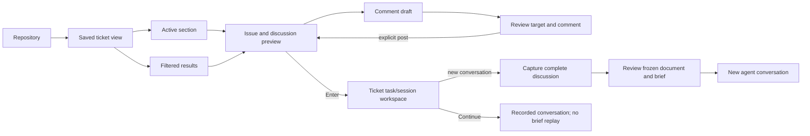

# Ticket browser design

Status: all 24 interview decisions synthesized into the published specification,
18 October 2026. The testing approach was confirmed before publication.
Implementation is on the combined ticket-browser branch for issues #19–#26.
Provider compatibility remains a technical validation gate; see
[delivery status](../native-discussion-delivery.md).

Published specification: [GitHub issue #18](https://github.com/andikon/treerails/issues/18),
labeled ready-for-agent. The local publication copy is ticket-browser.md.

## Workflow overview

1. Open a repository. Restore its last active named ticket view.
2. Browse one ticket column: Active at the top, filtered results below. Selection
   in either section updates the discussion preview on the right.
3. Use the guided filters or switch named views to find the required work. Applying
   filter/sort edits saves the current view; Duplicate preserves an existing view
   while exploring another combination.
4. Read the issue description and chronological discussion. Open the same ticket
   in GitHub or compose a comment without leaving the browser context.
5. Review a comment's target and text, then explicitly post. Restore unsent drafts
   across restarts; reconcile uncertain responses before any explicit retry.
6. Enter explicitly opens the selected ticket's existing task/session workspace.
   Returning restores the browser view, selection and reading context.
7. For a new agent conversation, fetch and capture the complete current discussion,
   review its frozen Markdown document plus task/checkout/handoff context, then
   approve a short starting prompt with the complete document supplied separately.
   Continue reattaches/resumes its recorded conversation without replaying context.



### Screen hierarchy

Conceptual layout with sample data; this is a design, not a captured application:

```text
TREE RAIL / example/atlas-api                 View: My ready tickets
-----------------------------------------+-----------------------------------
Active (2)                         [-]   | #42 Add readiness metadata [Open]
> #42 Add readiness metadata              | Labels: backend, ready
  Open | Needs input | backend, ready     | @author | created/updated time
  Also matches this view                 |
                                         | Issue description
  #51 Investigate timeout                | Headings, lists, code, references
  Open | Running | reliability           |
-----------------------------------------| Discussion
My ready tickets                         | @alice | timestamp
Open | Me | All: ready | Recent updates   |   Comment text
                                         | @bob | timestamp | edited
  #71 Fix retry handling                 |   Comment text
  Open | ready, reliability              |
                                         | Thread loading/completeness state
Loaded/matching counts and page state    | Draft available when applicable
-----------------------------------------+-----------------------------------
f filters · v views · c comment · o GitHub · ? actions
```

The Active block remains separate from filter criteria and is bounded to roughly
one third of the column. Its count remains visible when collapsed. Both sections
share a single selected-ticket identity and right-hand preview; they are not
additional kanban columns. Narrow terminals show the focused pane, with ordinary
pane navigation retained and no basic-navigation legend.

### Browser actions and input ownership

| Context | Key | Meaning |
| --- | --- | --- |
| Ticket browser | `f` | Guided filter editor |
| Ticket browser | `v` | Saved-view management |
| Ticket browser | `c` | Compose/restore a draft for the selected issue |
| Ticket browser | `o` | Open the selected issue in GitHub |
| Ticket browser | `a` | Collapse/expand Active |
| Ticket browser | `R` | Explicit refresh |
| Ticket browser | `?` | Context action guide |
| Ticket browser | `Enter` | Open the selected ticket's task/session workspace |
| Filter editor | `Ctrl+s` | Apply and save the view's filters/sort |
| Comment editor | `Ctrl+s` | Review comment; does not post |
| Comment review | `y` | Explicitly post the reviewed comment |
| Text editing | Ordinary characters/paste | Text, including workflow-key letters |

The browser's shortcuts apply only in that context. Existing ticket-workspace,
basic-worktree and agent-input bindings retain their meaning. Agent-input escape
continues to respect its configured binding. Do not let a global diagnostics or
workflow shortcut steal ordinary text from a comment/filter editor. Legends show
the active context's non-obvious actions and fit whole hints to available width.

### State and failure behavior

| Situation | Required behavior |
| --- | --- |
| GitHub refresh updates order/metadata | Preserve issue identity, reading anchor and unfinished input. |
| A refresh removes the selected issue from the view | Keep its preview, marked no longer matching, until another selection. |
| A ticket also belongs in Active | One card in Active; no duplicate below; distinguish match count from visible rows. |
| A closed issue still has active local work | Keep it in Active with its closed state visible. |
| Another page is loading or failed | Retain loaded rows and show loading/error; do not call the result complete. |
| Search exceeds GitHub's accessible result limit | Explain the limit and require narrower criteria to reach the rest. |
| GitHub is offline/unavailable | Show cached results/discussion with freshness, query association and completeness; editing drafts and existing hosted work remain available. |
| There is no cache for this query | Say unavailable/not cached, not zero matching tickets. |
| A comment post definitively fails | Retain draft and target; show the error. |
| A comment post may have succeeded | Persist confirmation-unknown status, refresh discussion and show possible matches; require an explicit resolution/retry. |
| A comment post succeeds | Clear its draft, refresh thread and reveal the posted comment. |
| Full discussion cannot be fetched | Do not approve a partial snapshot as complete; block fresh context capture. |
| Provider cannot receive the complete retained document | Block the new start; do not truncate, summarize or start with missing context. |
| Snapshot file is missing/changed | Do not substitute a newer discussion under the old approval. |
| Worktree is cleaned up | Retain conversation records and their approved discussion artifacts. |

### Detailed defaults included in the specification

These complete the mechanical behavior without adding another workflow:

- Per-repository ownership uses the GitHub host/repository identity in the chosen
  configuration context. Local clones/worktree paths do not create independent
  copies of that repository's saved views or issue drafts. Different repositories
  and explicit configuration contexts remain separate. Me resolves to the active
  authenticated GitHub identity; review shows the account used to post.
- Cards show issue number, title, open/closed state and named labels; Active cards
  add the relevant task/agent attention or recovery indicator. Long titles/labels
  may wrap or show an overflow count, with complete metadata in the preview.
- State offers Open, Closed and All. No included labels means no label constraint;
  selecting conflicting include/exclude criteria is reported before Apply.
  Structured constraints cannot be overridden by text entered in the search field.
- A saved view has a stable identity independent of its editable name. Names are
  unique within the repository. Removing a view never removes tickets, work,
  drafts or snapshots; deleting the final view restores an Open tickets default.
- Canceling the filter editor leaves the applied/saved view unchanged. Leaving a
  comment editor retains its draft; discarding comment text is an explicit action.
  Review freezes the repository, issue and comment text being posted, not whatever
  ticket happens to be selected after a background refresh.
- On an explicit view switch or filter Apply, retain the selected issue if it is
  still visible in Active/results; otherwise select the first visible ticket or
  show an empty preview. Preserve unsent drafts independently. The keep-reading
  no-longer-matches behavior applies to background refresh, not forced selection
  of an unrelated old issue after the user deliberately changes the view.
- Active collapse state is remembered per repository. Selection moves through the
  column's visible cards, and preview focus scrolls discussion. An Active count
  and attention indication remain visible when its rows are collapsed.
- Body and discussion loading are independent. Preview can display cached/fetched
  content while more comments load, with an explicit incomplete state. New-session
  context capture always fetches all accessible comment pages to completion.
- Full discussion means the accessible issue description and current comment
  bodies, with authors, timestamps and source references. It does not claim deleted
  comment history, downloaded attachment binaries or GitHub's entire event timeline.
- Metadata-only refreshes and new comments do not masquerade as an issue-body
  requirements revision or send instructions into an existing conversation.
- Settings/view/draft/reference saves preserve comments, unrelated fields and
  concurrent changes under ADR 0001. Same-view conflicts require resolution;
  background cache writes must not overwrite view definitions or drafts.

## Verification required before delivery

- Restore different saved views/filters/order for two repositories after restart.
- Match combined labels/assignees and text scopes on GitHub, including matches
  beyond the first loaded page; no silent 100-result subset filtering.
- Keep a nonmatching active issue visible once, including Ready/Needs input,
  unresolved execution and closed-but-active cases; bound and collapse Active.
- Preserve selection/scroll/drafts during paging, filter changes and refresh;
  distinguish empty, stale, incomplete, unavailable and rate-limited states.
- Render long Markdown bodies/comments, author/timestamp/edited metadata and link
  references at supported wide and narrow terminal sizes.
- Exercise comment compose/review/post, cancel/restore, confirmed success,
  permission failure and response-loss/restart without an automatic duplicate send.
- Capture a multi-page discussion larger than current inline limits. Prove complete
  immutable artifact delivery on the supported Copilot version before declaring
  native new-session support; changing command-line caps alone is insufficient.
- Verify new-session approval/retry/handover use the exact approved artifact, while
  Continue never replays it and cleanup never deletes it.
- Preserve concurrent view/draft/config changes and reject unavailable or modified
  snapshot artifacts without changing checkout ownership.

The decision record and primary-source findings below retain interview provenance.

## Purpose

Help one developer find the right GitHub ticket in a large repository, read its
discussion, and move into the existing ticket/task/agent workflow deliberately.
Keep each project's preferred ticket filters across Tree Rail restarts.

## Requirements established by the request

- Show one column of ticket cards, inspired by GitHub planning boards, rather than
  multiple simultaneous kanban columns.
- Include each ticket's title, status and labels in the list.
- Place a preview to the right of the selected ticket.
- Display the GitHub issue description followed by comments from their authors.
- Filter the ticket column and persist the chosen filtering per project.
- Support examples such as ready tickets assigned to the current user in one
  project, and tickets labeled backend in another project.
- Allow writing a comment and quickly opening the ticket in GitHub.
- Keep legends focused on non-obvious workflow actions; do not repeat routine
  Vim movement, search, or entering input.

## Existing behavior to account for

- A Project is a repository in Tree Rail's vocabulary. A GitHub Projects planning
  board is a separate concept, not the same project identity.
- Tickets remain GitHub Issues, as established in ADR 0003. Tasks and agent
  conversations remain Tree Rail workstreams, as established in ADR 0004.
- The current Issue model has number, title, body, OPEN/CLOSED state and URL. It
  does not carry labels, assignees or discussion comments.
- Listing currently fetches at most 100 issues across all states. Filtering that
  local subset alone would miss matches in a large repository.
- Current Open creates durable ticket state and a default local task when none
  exists. Passive preview must have a separate read path if it is to remain free
  of those effects.
- Existing offline fallback includes previously retained workflow tickets, not a
  complete cached result set for a saved filter.
- Starting briefs currently capture the issue body and task context. Reading or
  adding comments does not currently change a brief. Q8 below intentionally
  expands new-session context to include the discussion; existing conversations
  must not silently receive new instructions as a side effect of browsing.

Source: src/workflow.rs (Issue, Github::list/get, Command::List/Open), src/app.rs
(ticket_key), src/hosted.rs (starting_brief), CONTEXT.md and ADRs 0003–0004.

## Verified GitHub capabilities and constraints

- Issue queries support labels, assignees (including `@me`), issue state and text
  search. Multiple separate label qualifiers are AND; comma alternatives within
  a label qualifier are OR. Examples: `is:open assignee:@me label:ready` and
  `is:open label:backend`.
- GitHub issue state and a GitHub Projects board's Status field are different.
  The board field is a configurable single-select belonging to a particular
  planning board. Its field/option identity and access need to be selected
  deliberately if included. The documented classic-token/CLI flow requires
  `read:project` to read Projects; issue access alone is insufficient.
- Projects filtering and issue search are different query languages. A shared
  UI cannot assume the same free-text query works for both.
- Queries must filter remotely before loading displayed results; filtering only
  the existing first 100 issues would produce false empty or partial views.
  GitHub search has a 1,000-result query ceiling; completeness, paging and any
  request failure must be visible rather than implying an exhaustive result.
- Comments expose stable IDs, authors, bodies, timestamps and URLs. Comment
  listing is paginated and ordered by ascending ID; long threads require visible
  loading/completeness behavior.
- Reading an issue does not imply permission to post. Posting can fail or be rate
  limited and triggers GitHub notifications. Keep any failed draft and avoid a
  blind retry after an uncertain response, which can create duplicate comments.
- `gh issue view --web` provides an existing browser-opening path. A new comment
  can be sent using a UTF-8 body file; no shell interpolation of comment contents
  is necessary.

Primary sources checked 18 October 2026:

- [GitHub CLI issue list](https://cli.github.com/manual/gh_issue_list)
- [GitHub issue filtering and search](https://docs.github.com/en/issues/tracking-your-work-with-issues/using-issues/filtering-and-searching-issues-and-pull-requests?tool=cli)
- [Projects filtering](https://docs.github.com/en/issues/planning-and-tracking-with-projects/customizing-views-in-your-project/filtering-projects)
- [Projects API and authentication](https://docs.github.com/en/issues/planning-and-tracking-with-projects/automating-your-project/using-the-api-to-manage-projects)
- [Single-select fields](https://docs.github.com/en/issues/planning-and-tracking-with-projects/understanding-fields/about-single-select-fields)
- [Search API limits](https://docs.github.com/en/rest/search/search#about-search)
- [CLI API pagination](https://cli.github.com/manual/gh_api)
- [Issue comments API](https://docs.github.com/en/rest/issues/comments)
- [View issue / open browser](https://cli.github.com/manual/gh_issue_view)
- [Post issue comment](https://cli.github.com/manual/gh_issue_comment)

## Accepted decisions

### Q1 — Issue-based filtering

Use GitHub issue state, labels and assignees. A label such as ready expresses
readiness; actual GitHub Projects board fields/integration are out of scope.
Do not conflate this readiness label with agent attention Ready or local task
progress. The visual inspiration is a planning board, but this is an issue browser.

### Q2 — Multiple saved ticket views

Each repository can have multiple named saved ticket views, such as My ready
tickets and Backend. Restore that repository's last active view on return and
after restart. Different repositories keep independent preferences.

### Q3 — Preview before entering ticket work

Moving the ticket selection updates the right-hand preview. Enter explicitly opens
the existing ticket/task/session workspace. Previewing does not create local tasks,
a worktree or an agent conversation. Keep the direct basic-worktree path available.

### Q4 — Read discussion and post new comments

Show issue description followed by comments, oldest first, with author and
timestamp. Provide compose, review and explicit post for a new comment, plus a
quick open-in-GitHub action. Editing/deleting existing comments stays in GitHub
for this version.

### Q5 — Guided filter editing

Provide a guided editor with issue state, assignees including me, labels and text
search. Display the active filters above the ticket column. Raw GitHub query entry
is not part of the first version's editing experience.

### Q6 — Apply saves the active named view

Applying filter edits updates the list and persists those edits into the current
named view. Unfinished editor values do not save until Apply. Offer Duplicate view
to keep the original while trying a different combination.

### Q7 — Ordering belongs to a saved view

Default to most recently updated first. Persist each named view's ordering so a
backlog queue can instead use oldest-created-first, for example.

### Q8 — Full issue discussion in new-session briefs

Include the full issue thread in the starting brief of a new agent conversation,
alongside the issue description, task/worktree context and optional handoff.
This explicitly replaces the recommendation to keep discussion out of agent
context. It applies to new conversations; it is not permission to inject comments
into a live conversation or replay a brief when continuing one.

This changes the existing brief content contract. The host currently caps a
starting brief at 48 KiB, and Copilot receives it through launch arguments
(src/hosted.rs, src/copilot.rs). Full-thread capture, approval, completeness and
delivery for a long thread therefore need explicit design decisions; do not
silently truncate or summarize and call the result the full discussion.

Long-thread feasibility checked 18 October 2026:

- The current whole-brief launch argument is constrained by Windows
  [CreateProcessW's command-line limit](https://learn.microsoft.com/en-us/windows/win32/api/processthreadsapi/nf-processthreadsapi-createprocessw)
  of 32,767 characters for the entire command line, including its terminating
  NUL. It can fail before the existing 48 KiB UTF-8 guard. Host IPC also has a
  separate 4 MiB serialized-message limit (src/host.rs).
- Current GitHub documentation describes
  [file context](https://docs.github.com/en/copilot/how-tos/copilot-cli/use-copilot-cli/overview#include-a-specific-file-in-your-prompt)
  and [initial-prompt attachments](https://docs.github.com/en/copilot/reference/copilot-cli-reference/cli-command-reference#command-line-options).
  These are candidates for a complete local discussion document plus a short
  starting prompt, not evidence that the tested Copilot 1.0.94 supports the exact
  required launch behavior. Compatibility must be proved before implementation
  promises that delivery route.
- Preserve the distinction between retaining/supplying the full captured thread
  and guaranteeing that a model has consumed every word. Never silently replace
  the requested full thread with a summary or partial comment page.

Q13 below settles the desired delivery through a captured document. Provider
compatibility remains an implementation prerequisite, not a verified capability
of the currently tested Copilot version.

### Q9 — Filter combination rules

Different filter categories combine with AND. Included labels support All selected
or Any selected, with All the default. Any excluded label hides a ticket. Specific
assignees match any selected person; also offer Anyone, Me and Unassigned. Thus
open + me + all of ready/backend + excluding blocked is an inspectable view.

### Q10 — Initial view and view management

Start a new repository with Open tickets: open issues, unrestricted assignees and
labels, most recently updated first. Support create, duplicate, rename and delete
for named views. Do not assume or create readiness labels for a repository.

### Q11 — Review and freeze a complete discussion snapshot

Fetch the complete current issue description and discussion before showing a new
conversation's starting brief. Freeze exactly the discussion snapshot reviewed and
approved. Later comments do not silently change that conversation's captured
context. A later new conversation captures the thread again; Continue does not
replay the starting brief.

### Q12 — Persistent per-issue comment drafts

Keep an unsent draft per repository/issue across ticket switches and restarts.
Retain it through posting failures. Clear it only on confirmed successful posting
or explicit discard, and never automatically post a restored draft. An uncertain
response needs a separate reconciliation decision rather than a blind retry.

### Q13 — Complete context document and short starting prompt

Retain the full frozen discussion as a Markdown document and supply it with a
short starting prompt. Let the user inspect the exact captured document before
approval, and retain it with the conversation after worktree cleanup. Block a
start if the supported agent cannot receive the complete document; do not
silently truncate or summarize it. Q20 settles authoritative storage outside
the worktree and combined configuration.

### Q14 — Formatted terminal discussion preview

Render headings, lists, checkboxes, quotes and code blocks as readable terminal
Markdown. Include issue author/metadata, then chronological comments with author,
timestamp and edited marker. Represent links, images and attachments as readable
references that can be opened in GitHub. No browser rendering is required.

### Q15 — Active section above the saved view's results

User correction to the recommended separate shortcut: show a distinct Active
section at the top of the same ticket column. Show tickets currently being worked
on there, independently of whether they match the saved filter. Keep the saved
view's result section below it and the shared issue preview on the right.
Q17–Q19 below settle membership, repository scope, duplicate handling and height.

Conceptual layout; sample tickets, not application output:

```text
Ticket column                         Issue preview
----------------------------------    ----------------------------------
Active                                #42 Add readiness metadata [Open]
  #42 Add readiness metadata          Labels: backend, ready
  Running | backend, ready            Author and issue description

My ready tickets                      Discussion
  Open + Me + label:ready              Author A | timestamp
  #71 Fix retry handling                Comment body
  Open | ready, reliability            Author B | timestamp
                                         Comment body
                                      [Comment] [Open in GitHub]
```

### Q16 — Automatically paged matching results

Filter on GitHub and fetch results in pages. Automatically request the next page
as the user approaches the loaded end. Expose loaded count, total when available,
and loading/end/error/limit states. A first page of 100 is never presented as the
complete repository or an exhaustive result set.

### Q17 — Active membership

A ticket belongs in Active if a local task is In progress, or a managed agent is
live or has unresolved execution requiring recovery. Ready still counts while
the agent owns the checkout. An unused worktree or historical conversation alone
does not count. A closed issue remains in Active while this local work is active.

### Q18 — Repository scope and unique ticket cards

Active is scoped to the selected repository. Display a ticket once: a ticket in
Active is not duplicated in the filtered section. Mark whether the active ticket
also matches the view; keep match counts and displayed-row counts unambiguous.

### Q19 — Bounded Active section

Active is collapsible and shows its count. Cap its expanded height at roughly one
third of the ticket column, scrolling within it as needed so filtered results
remain usable. Prioritize Needs input and recovery problems. The saved view's
ordering applies to filtered results, not the Active attention ordering.

### Q20 — Separate retained discussion documents

Keep settings, saved views, comment drafts and snapshot references in the combined
configuration file. Store authoritative frozen Markdown discussion documents
separately in Tree Rail's data directory, outside worktrees, and retain them after
checkout cleanup. This explicitly extends ADR 0001 for discussion document bodies
only; ADR 0008 records the accepted exception and its trade-off.

### Q21 — Stable refresh and offline reading

Refresh quietly while preserving selection, reading position and unfinished
input. Keep a selected issue's preview marked no longer matching if refreshed
metadata removes it from the filter. Offline cached results/discussion remain
readable with freshness/completeness labels and drafts editable. Posting and fresh
discussion capture require GitHub connectivity; existing hosted work remains
accessible independently.

### Q22 — Reconcile uncertain comment posting

Retain the draft and mark confirmation unknown if the post might have succeeded
without its response reaching Tree Rail. Refresh the discussion and show possible
matching comments for user verification. Require an explicit choice before retry;
never silently repost. Confirmed success clears the draft and reveals the posted
comment. Text similarity alone is not proof that an uncertain send succeeded.

### Q23 — Contextual browser actions and text ownership

Use f filters, v saved views, c comment, o GitHub, a Active collapse/expand, R
refresh and ? actions in the browser. Ctrl+s applies filter edits or reviews a
comment, and y posts only from comment review. Text editors own ordinary letters.
Retain existing pane/input navigation; show the focused pane when narrow. Legends
omit routine navigation. The action table above is the consolidated key map.

### Q24 — Text-search scope

Search titles and descriptions by default, with an explicit option to include
comments. Save this scope per named view and display it in the filter summary.

## Specification handoff

All 24 product questions are answered and the user invoked to-spec to synthesize
and publish the design. The existing workflow command/event testing approach was
explicitly confirmed. The remaining provider-version/file-context proof is an
implementation prerequisite, not a question for the user to investigate. Publishing
this specification is not implementation or authorization to post trial comments
on other issues or launch paid provider work.

## Decisions and architecture

Ticket data stays on GitHub and progression remains user-managed. Saved views,
active-view memory and comment drafts must respect ADR 0001's single-file
persistence and concurrent-edit preservation. Q20 and ADR 0008 explicitly extend
ADR 0001 to keep frozen discussion document bodies outside the combined file;
their metadata stays within it.
ADR 0007 records why new conversations retain an approved full-discussion
snapshot rather than dynamically changing their context as comments arrive.
No new ADR is needed for the readily reversible visual layout itself. Revisit ADR
0003 explicitly if a later proposal introduces Tree Rail-owned ticket status or
automated ticket progression rather than mirroring GitHub.
